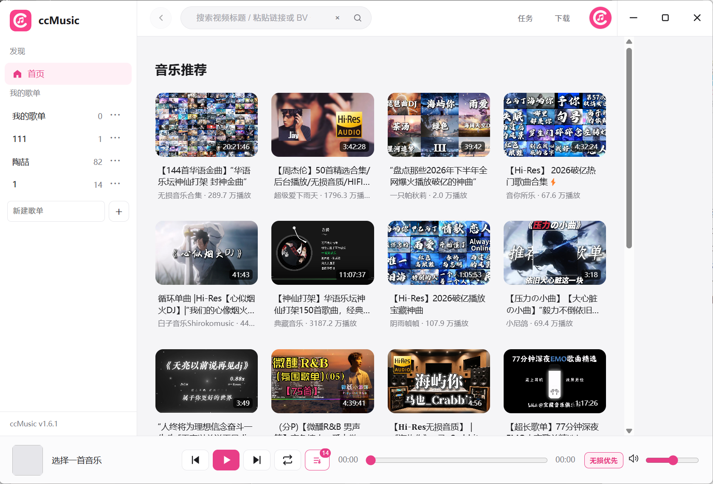
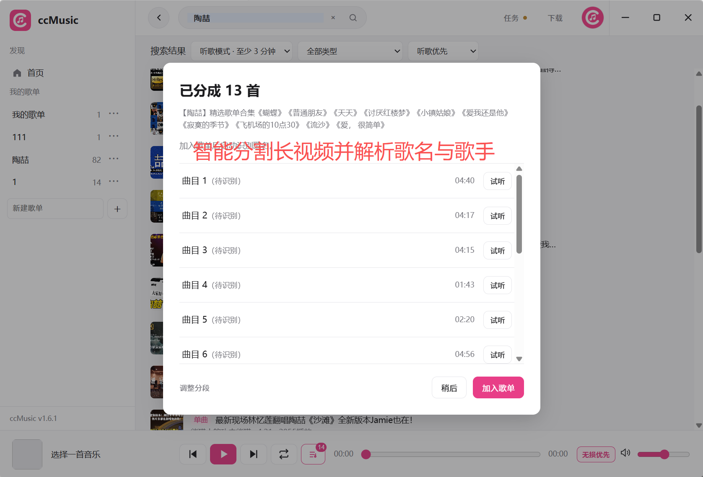
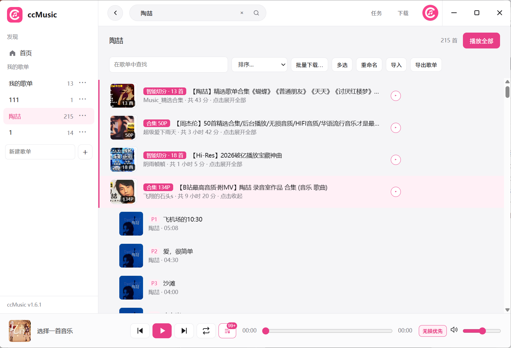
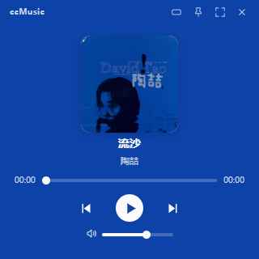

# ccMusic

把 B 站音乐当歌听的 Windows 桌面播放器，支持歌单、智能分歌、听歌识曲和音频下载。

## 安装

**[下载解压即用 ZIP：ccMusic-1.8.0-Windows-x64.zip](https://github.com/Quinloan/ccMusic-Bilibili-Player/releases/download/v1.8.0/ccMusic-1.8.0-Windows-x64.zip)**，解压整个文件夹后双击 `ccMusic.exe`。ZIP 的应用内更新会转为安装版；如需继续免安装使用，请手动下载新版 ZIP。

需要安装的用户可下载 [Windows 安装包](https://github.com/Quinloan/ccMusic-Bilibili-Player/releases/download/v1.8.0/ccMusic-Setup-1.8.0.exe)，适用于 Windows 10/11 x64。覆盖安装保留本机歌单和登录状态。`latest.yml` 供自动更新使用，无需手动下载。默认不捆绑 Whisper，无需另外注册识曲服务账号。

v1.8.0 新增紧凑/方形小窗、封面主色背景和直接下载时的智能分歌，完善下载窗口布局，并修复部分欧美歌曲的歌手与专辑封面补全。完整说明见 [v1.8.0 发布说明](RELEASE_NOTES_v1.8.0.md)。

## 功能

1. **智能分割**：将长视频音乐合集拆成可独立播放的单曲，结合简介时间轴与音频分析定位切点；分割后直接预览、试听，也可调整边界。

2. **听歌识曲**：确认分段后立即入库并可播放，后台逐首更新歌名、歌手；网易云指纹与 Shazam 配合，无需额外注册识曲账号。

3. **歌曲资料**：从单曲/P 标题、简介或识曲结果匹配歌名、歌手与专辑封面；资料不足时补查 QQ。右键可解析单首或整组，上百个分 P 逐首更新并显示进度，手动编辑的名称和歌手优先保留。

4. **音乐搜索**：搜索歌手、歌曲、完整视频标题，或粘贴 BV / av / B 站链接；默认筛选至少 3 分钟的内容，支持单曲、长视频筛选和滚动加载。

5. **歌单管理**：添加前选择歌单，多 P 自由选曲；支持查找、多选、移动、排序、导入导出、整组移除、撤销和恢复整段。

6. **音频下载**：优先获取当前账号可用最高音质音源，统一保存为320 kbps MP3，写入歌名与歌手；下载与转换独立排队，可边下载后续歌曲边转换已下载歌曲。支持单首、任意多选和分段下载，以及进度、取消、重试；未登录时先提示登录。

7. **播放控制**：默认开启无损优先，支持待播队列、列表循环/单曲/随机模式、媒体快捷键和托盘控制。

8. **音量平衡**：持续测量并平滑减小歌曲间的响度差异，独立于用户音量设置，记住曲目补偿并保留歌曲动态。

9. **首页推荐**：下滑自动追加适合听歌的音乐视频、去除重复内容，保留浏览位置，加载失败可重试。

10. **任务管理**：分别展示整批保存、共用音源和逐曲转换进度；可取消这批、取消全部和清理已结束，取消后无需再逐条移除；清理记录保留已下载文件。

11. **最近播放**：记录成功播放的歌曲，最近听过的排在前面；支持查找、再次播放、移除和清空，最多保留500首，重启仍保留。

12. **应用内更新**：右上角头像 →「检查更新」，查看说明后确认下载，显示进度、失败可重试，再点击「重启完成更新」。自动检查可以关闭，普通退出不会自动安装；尚有下载、分歌和识曲任务时，需要先完成或取消任务。run.bat 测试模式不下载安装更新。

13. **小窗播放**：紧凑与方形两种尺寸，支持置顶、封面主色背景、曲目切换、进度和音量控制；切换小窗继续原有播放。可用标题栏按钮、Ctrl+Shift+M 或托盘菜单切换。

最高可用音质取决于 B 站登录状态、账号权益和源音轨；MP3是有损格式，320 kbps不会提升低音质源的实际质量。

识曲和切分可能需要手动修正，尤其是翻唱、混音和连续串烧；同名歌曲信息与演唱者以实际内容为准。

## 界面预览

首页、分歌和歌单示例沿用之前提供的截图；小窗为本版布局示例，展示示例曲目。










## 数据

歌单、队列和登录信息保存在本机应用数据目录，与安装目录分开。指纹识曲会向服务发送音频指纹；资料查询会发送歌名/歌手等检索词。默认不使用本地语音模型。开发者可另行准备可选 Whisper，转写在本机进行，歌词搜索发送选取的短句。临时音频按任务/会话生命周期清理，下载任务记录暂不跨重启保留。

## 从源码运行

需要 Windows x64、Node.js 22.19 或更新版本、npm 和 Python 3.11 或更新版本。

```powershell

npm ci

python scripts/setup-release-resources.py

npm start

# 构建 Windows 安装包

npm run dist

```

资源准备脚本只用于开发/构建，从独立开发资源页下载固定资源并校验 SHA256，默认不下载 Whisper。终端用户安装后无需执行这些步骤。附带 FFmpeg 精简构建的源码、配方、配置与许可证另见[开发资源页](https://github.com/Quinloan/ccMusic-Bilibili-Player/releases/tag/build-resources-v1.6.3)和 [第三方说明](THIRD-PARTY-NOTICES.md)。

核心回归示例：`node scripts/test-audio-analysis.cjs`、`node scripts/test-downloads.cjs`、`node scripts/test-playback.cjs`。界面回归需另外安装 Playwright，并通过 `CCMUSIC_PLAYWRIGHT` / `CCMUSIC_BROWSER` 指定库和 Chromium/Edge；使用模拟 IPC/媒体，不启动 Electron 或播放真实音频。部分处理函数回归需要本地测试音频，不随源码分发。

应用源码采用 [MIT](LICENSE)。使用与下载应符合内容权利人的授权和平台规则，软件不会绕过账号权益。

