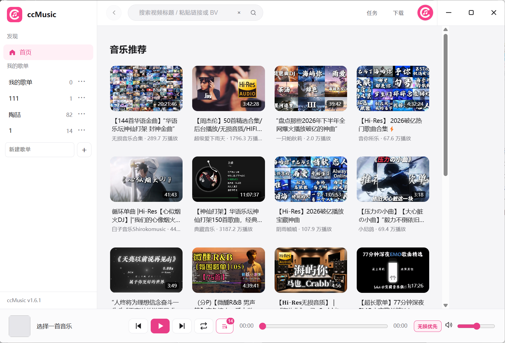
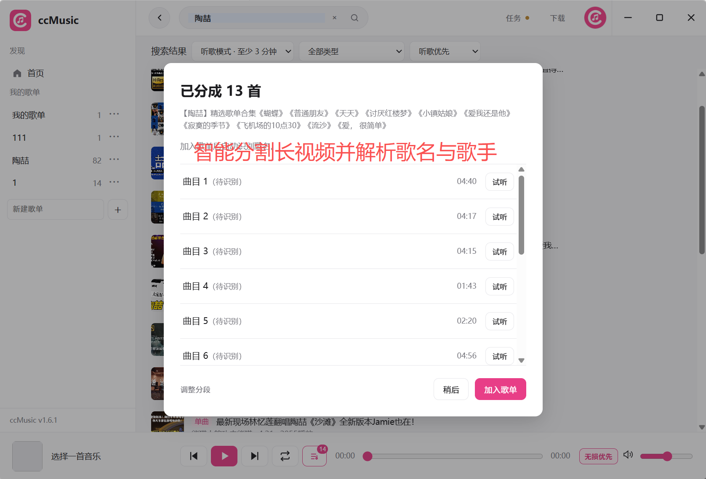
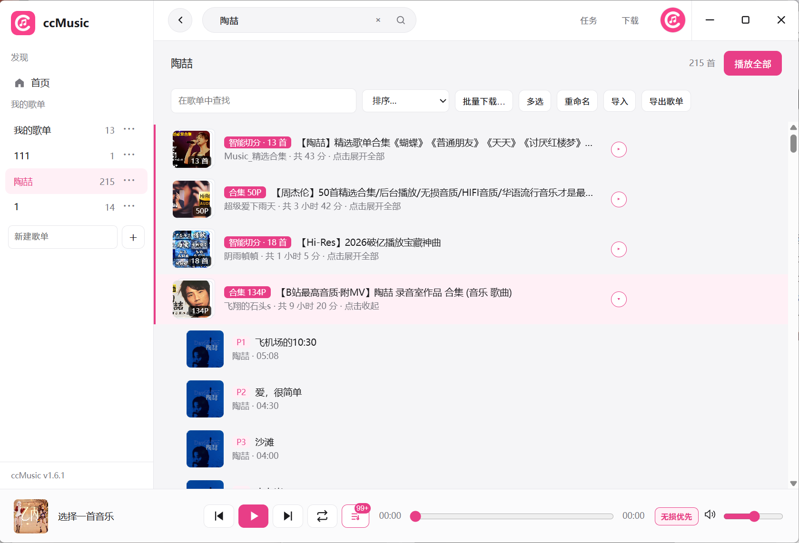
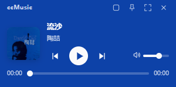
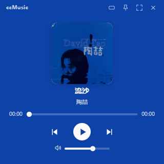

# ccMusic v1.8.0

## 下载软件

**[下载解压即用 ZIP：ccMusic-1.8.0-Windows-x64.zip](https://github.com/Quinloan/ccMusic-Bilibili-Player/releases/download/v1.8.0/ccMusic-1.8.0-Windows-x64.zip)**

解压整个文件夹，双击 `ccMusic.exe` 即可使用。需要安装的用户可下载 [Windows 安装包](https://github.com/Quinloan/ccMusic-Bilibili-Player/releases/download/v1.8.0/ccMusic-Setup-1.8.0.exe)，覆盖安装保留本机歌单和登录状态。

ZIP 版的应用内更新会转为安装版；如需继续免安装使用，请手动下载新版 ZIP。`latest.yml` 用于自动更新，普通用户无需下载。

## 功能

1. **智能分割**：将长视频音乐合集拆成可独立播放的单曲，结合简介时间轴与音频分析定位切点，支持预览、试听和调整分段。
2. **听歌识曲**：确认分段后立即加入歌单，后台逐首补齐歌名、歌手和专辑封面，不必等整组完成；无需额外注册识曲账号，可自行修改资料。
3. **歌曲资料**：结合单曲标题、多 P 标题和识曲结果匹配信息；右键可解析单首或整组，手动填写的歌名和歌手优先保留。
4. **音乐搜索**：搜索歌手、歌名、完整视频标题，或粘贴 BV / av 号及 B 站链接；支持单曲、长视频筛选和下滑加载。
5. **歌单管理**：添加前选择歌单，多 P 自由选曲；支持查找、排序、多选、移动、导入导出、整组移除与撤销。
6. **MP3 下载**：选择当前账号可用的最高音质音源，统一保存为 320 kbps MP3，并写入歌名和歌手；支持单首、任意多选及分段下载，长视频也可直接智能分歌后下载。
7. **最近播放**：快速找回听过的歌曲，支持搜索、重新播放、移除和清空，最多保留 500 首，重启后仍保留。
8. **播放控制**：默认无损优先，支持音量平衡、待播队列、列表循环、单曲循环、随机播放、媒体快捷键与托盘控制。
9. **首页推荐**：下滑自动加载更多音乐视频，去除重复内容并保留浏览位置，加载失败可重试。
10. **任务管理**：查看分歌、识曲与下载进度，支持批量取消和一键清理结束记录，完成后提醒。
11. **小窗播放**：紧凑与方形两种形态，封面主色背景、自动文字配色、置顶、切歌、进度和音量控制，随时返回主界面。
12. **应用内更新**：右上角头像 →「检查更新」，查看更新说明、下载进度并重启完成更新；自动检查可以关闭。

## v1.8.0 本次更新

1. **小窗播放**：新增紧凑、方形两种小窗，支持置顶、切歌、播放进度与音量控制；通过标题栏按钮、Ctrl+Shift+M 或托盘菜单切换，返回主界面继续原有播放。
2. **封面配色**：小窗直接使用专辑封面的代表色，自动选择清晰的深色或浅色文字，按钮和进度条同步配色；采用不透明纯色背景与圆角轮廓，记住小窗形态、位置和置顶状态。
3. **智能分歌下载**：直接下载长视频时，可以选择整段下载或先智能分歌；确认分段并识别后选择需要的歌曲，分别保存为 MP3，不必先加入歌单。
4. **下载界面**：音源和批次摘要与歌曲列表一起滚动，减少浮层遮挡，选择歌曲时能看清曲目信息。
5. **歌曲资料补全**：修复部分欧美合集只显示歌名、未补齐歌手和专辑封面的问题；兼容标题中的 Explicit 提示、合集装饰符和主唱/合作歌手署名。保留 Live、Remix 等版本区别，旧歌单可继续补全，无需删除重加。

## 界面示例

首页、分歌和歌单沿用之前提供的界面截图；小窗为本版布局示例，展示示例曲目。

## 使用说明

适用于 Windows 10 / 11 x64。最高可用源音质取决于 B 站登录状态、账号权益和视频音轨；MP3 为有损格式，320 kbps 不会提升低音质源的实际质量。复杂翻唱、混音和连续串烧仍可能需要手动修正。

运行资源与 FFmpeg 对应源码继续放在独立的[开发资源页](https://github.com/Quinloan/ccMusic-Bilibili-Player/releases/tag/build-resources-v1.6.3)，普通用户无需下载。默认不捆绑 Whisper。
