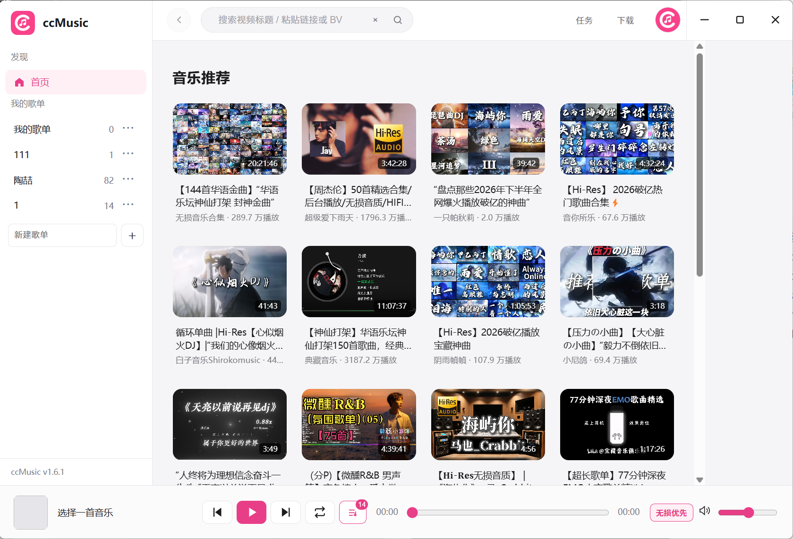
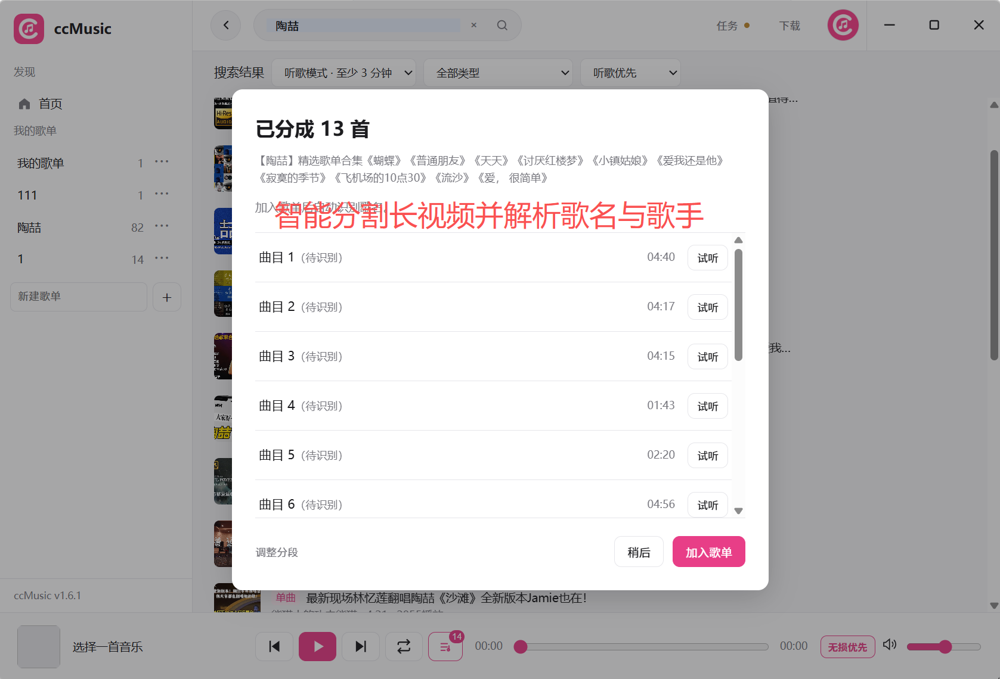
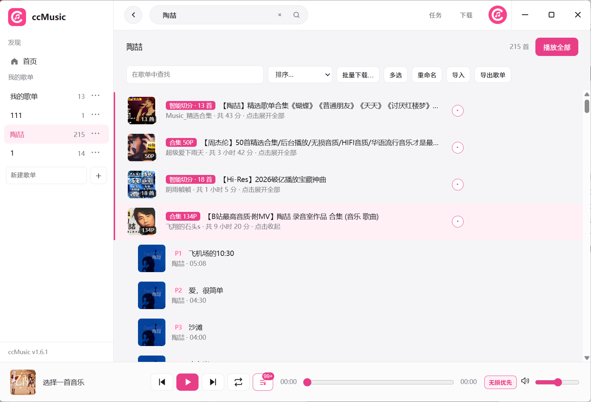

# ccMusic v1.9.0

## 下载软件

**[国内下载解压即用 ZIP：ccMusic-1.9.0-Windows-x64.zip](https://cnb.cool/Quinloan/ccMusic/-/releases/download/v1.9.0/ccMusic-1.9.0-Windows-x64.zip)** · [GitHub 备用下载](https://github.com/Quinloan/ccMusic-Bilibili-Player/releases/download/v1.9.0/ccMusic-1.9.0-Windows-x64.zip)

解压整个文件夹，双击 `ccMusic.exe` 即可使用。需要安装的用户可下载 [Windows 安装包（国内）](https://cnb.cool/Quinloan/ccMusic/-/releases/download/v1.9.0/ccMusic-Setup-1.9.0.exe) · [GitHub 安装包](https://github.com/Quinloan/ccMusic-Bilibili-Player/releases/download/v1.9.0/ccMusic-Setup-1.9.0.exe)，覆盖安装保留本机歌单与登录状态。

ZIP 版的应用内更新会转为安装版；如需继续免安装使用，请手动下载新版 ZIP。`latest.yml` 供自动更新使用，普通用户无需下载。

## 本次更新

1. **独立播放界面**：点击左下角封面，进入大封面、同步滚动歌词与封面虚化背景的播放页面，点击歌词可跳转；左上角箭头或 Esc 返回，播放不中断。设置可调整歌词、封面、背景和真实音频频谱的显示，以及歌词字号、颜色和时间偏移；默认显示歌词、封面与虚化背景，频谱默认关闭、颜色为白色。
2. **桌面悬浮歌词**：切换到其他软件也能看到歌词，鼠标移入显示工具栏，可调整字号、颜色、位置、单行/双行与时间偏移。歌词优先查询网易云音乐，缺失时尝试 QQ 音乐，不使用音频转写来获取歌词。
3. **外部歌单导入**：从侧栏加号导入网易云、QQ 音乐公开歌单，以及 B 站收藏夹、音频歌单或文字曲目清单；外部歌曲逐首匹配 B 站音源，修复只能取得前十首的问题。后台导入支持排队、收起、暂停后继续和重启恢复，并可保存未成功导入的曲目为 TXT，便于核对。
4. **歌单整理与备份**：新增「我喜欢」、歌曲与队列拖动排序、重复项整理、歌单备份与恢复；导入的 B 站收藏夹可检查新增内容，避免重复加入已有歌曲。
5. **本地音乐**：支持添加本地音频文件夹，读取歌名、歌手与封面，扫描新增文件；本地歌曲与 B 站歌曲共用播放队列。
6. **主题配色**：新增跟随系统、浅色、深色三种外观和五套强调色。深色背景统一为中性炭黑，主界面、设置与弹窗同步切换，小窗继续使用封面配色。
7. **播放器布局**：历史记录与下载记录移至侧栏，创建或导入歌单统一到加号菜单；底部播放器更紧凑，播放模式位于上一首左侧，音量移入悬浮竖向滑块，支持滚轮、点击与拖动调节。
8. **音量平衡升级**：采用 K 加权与门控响度统计持续估计歌曲响度，平滑补偿歌曲间的音量差，并加入独立限幅保护；保留用户音量设置和曲目动态，不以认证响度测量或完全消除听感差异为承诺。
9. **长音频续播**：仅为时长至少 30 分钟的音频记忆播放进度，普通歌曲重新点开从头播放；支持自定义全局快捷键。
10. **登录与播放维护**：完善登录 Cookie 的保存、响应更新及需要时的续期流程；播放接口临时拒绝时提供受限兼容请求和冷却处理，避免连续重试。平台验证、网络限制或账号状态仍可能影响播放，不保证消除所有 412 错误。
11. **双源更新**：GitHub 与 CNB 国内源同步提供本版 ZIP、安装包和更新清单，默认国内更新；安装版可在软件内检查、下载并重启更新。

## 主要功能

1. **智能分割**：将长视频音乐合集拆成可独立播放的单曲，结合简介时间轴与音频分析定位切点，支持预览、试听、调整分段与直接分歌下载。
2. **听歌识曲**：确认分段后立即加入歌单，后台逐首补齐歌名、歌手与专辑封面，支持整组或单首重新解析，并保护手动填写的资料。
3. **音乐搜索**：搜索歌手、歌曲、完整视频标题，或粘贴 BV / av 号与 B 站链接；支持类型、时长筛选和滚动加载。登录 B 站后使用账号环境搜索与获取推荐。
4. **歌单管理**：支持多 P 自由选曲、分组折叠、查找、多选、移动、排序、导入导出、备份恢复与撤销删除。
5. **MP3 下载**：获取当前账号可用音质音源，统一保存为 320 kbps MP3 并写入歌曲资料；下载与转换独立排队，支持单首、多选、分段、进度、取消与重试。
6. **播放体验**：支持待播队列、列表循环、单曲循环、随机播放、音量平衡、媒体快捷键、托盘控制与最近播放记录。
7. **小窗播放**：紧凑、方形两种形态，采用封面主色背景，支持置顶、切歌、进度与音量控制，记住形态和位置。
8. **任务管理**：集中查看分歌、识曲、下载和后台导入，支持批量取消与清理结束记录，清理下载记录不会删除已下载文件。

## 界面示例

以下首页、分歌、歌单与小窗截图沿用之前版本，仅展示基本功能；本版布局与配色已有调整。

## 使用说明

适用于 Windows 10 / 11 x64。最高可用源音质取决于 B 站登录状态、账号权益和视频音轨；MP3 为有损格式，320 kbps 不会提升低音质源的实际质量。歌单匹配、识曲、歌词及切分可能受平台验证、同名歌曲、版本差异、翻唱、混音或连续串烧影响，必要时需手动核对。

运行资源与 FFmpeg 对应源码继续放在独立的[开发资源页](https://github.com/Quinloan/ccMusic-Bilibili-Player/releases/tag/build-resources-v1.6.3)，普通用户无需下载。默认不捆绑 Whisper。
